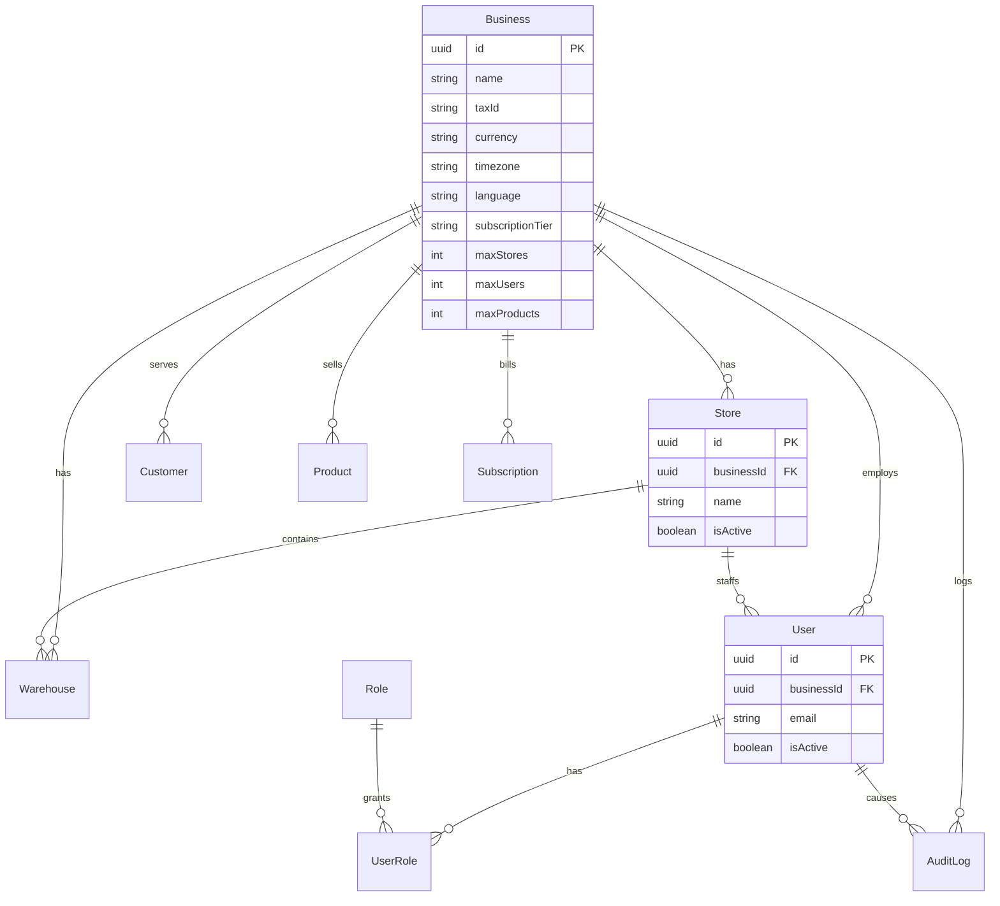
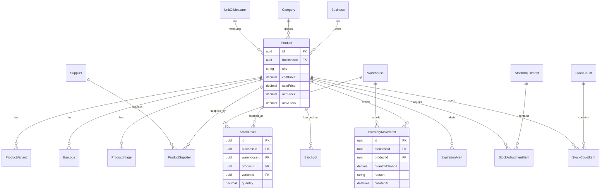
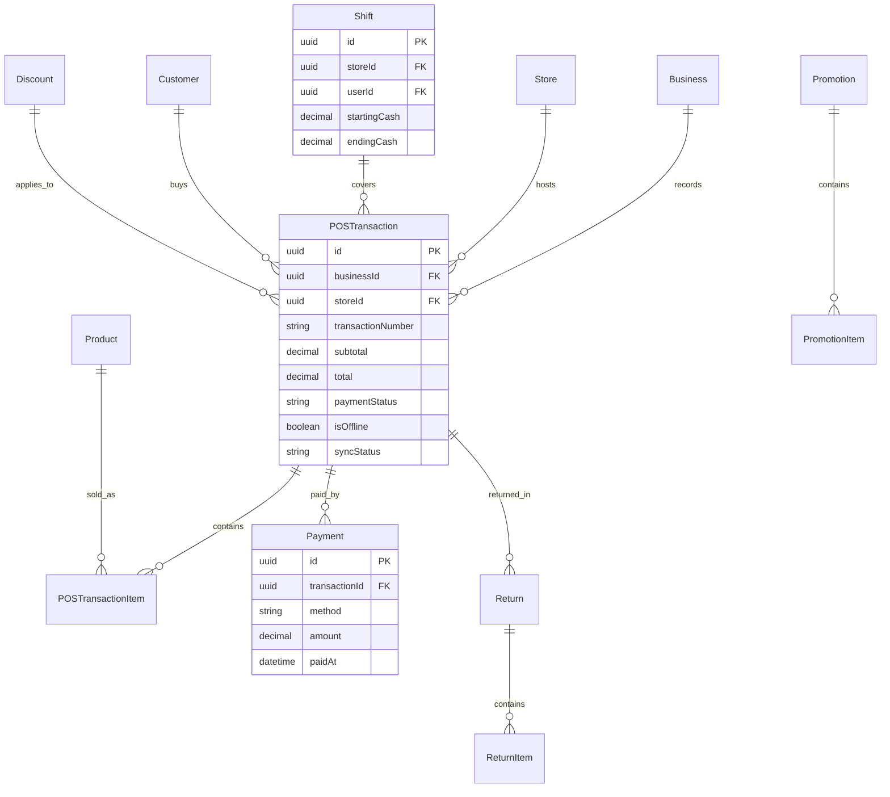
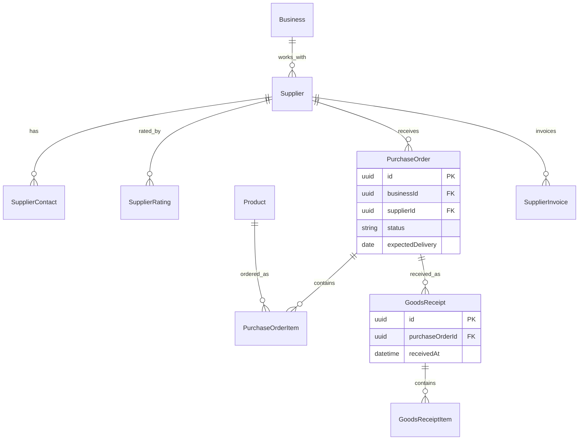
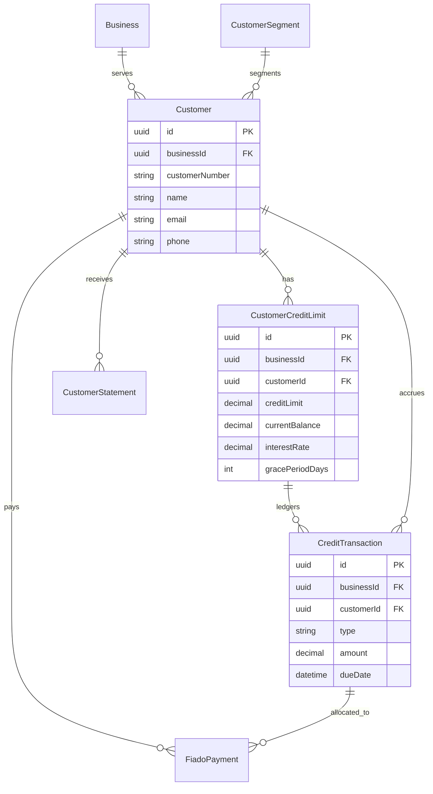
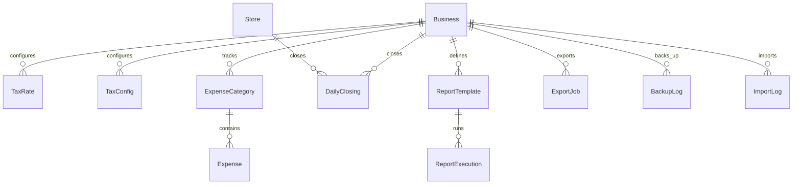
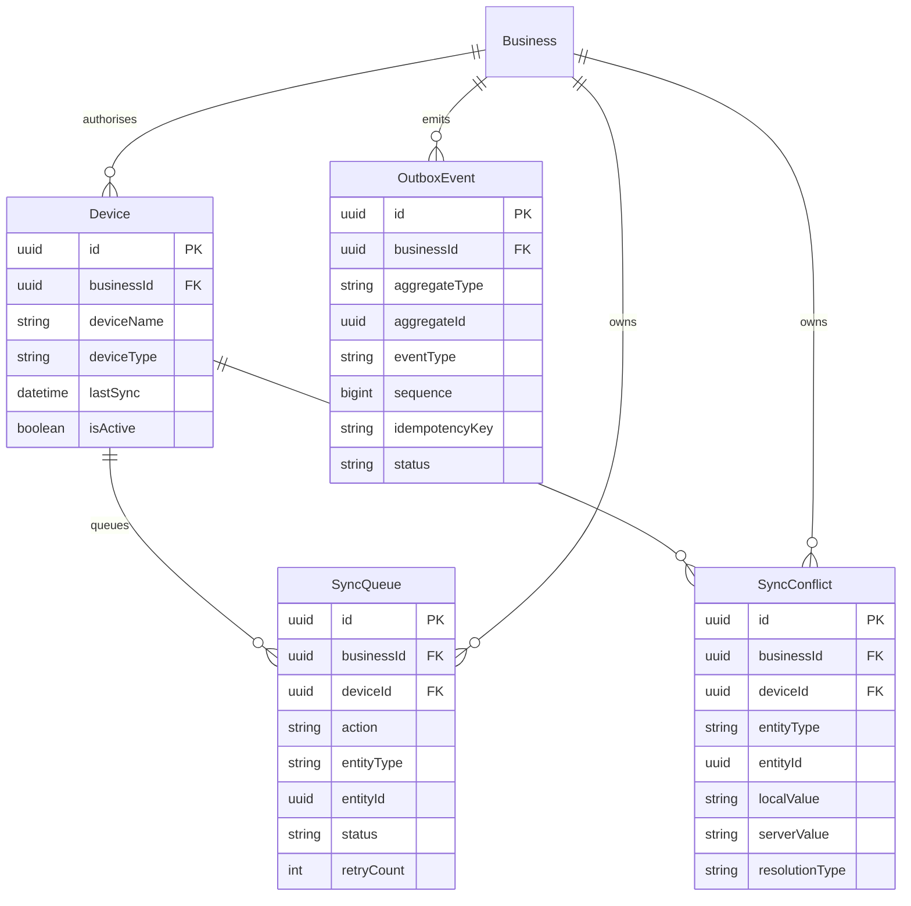
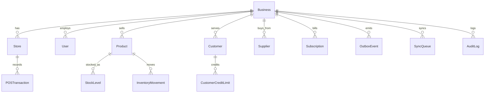

# PAGATEC Phase 2 — Complete Database Architecture v1.1 DRAFT

**Status: DRAFT — NOT APPROVED. Do not implement from this document alone.**
**Date:** 2026-11-25 — updated 2026-11-25 after PDF/DOCX extraction (see §1.2 / §1.4)
**Repository:** BigOn1110/pagatec-inventory, branch `main`
**Owner:** Yeney B. Herrera, CEO, TECCEF.CORP
**Previous documents:** Database Design Document v1.0 (2026-07-30, Pending Approval), Product Vision & Business Requirements v1.0 (2026-07-30, incomplete), SAD v1.2 (2026-07-30, reported Approved — Phase 2 Ready)

> PAGATEC is a documented product, not implemented software. An approved architecture is not an implemented architecture, and a database design document is not a deployed database. Nothing in this draft claims that code, a database, an API, or a sync service exists.

## How to read this draft — labels

Every statement in this draft carries one label. Do not drop the label when quoting it.

- **[Verified]** — Directly observable in the repository, checked 2026-11-25 by plain-text reading of the repository text files, or by the GitHub file listing.
- **[Historical]** — Previously established project decisions, company context, or requirements, supplied in the project record / ChatGPT handoff 2026-11-25. Not independently re-verified from the binary files in this pass.
- **[Proposed]** — A recommendation in this draft, subject to Yeney's approval. Not an approved decision.
- **[OPEN]** — An unknown that must not be invented. A decision is required before implementation.

---

## 1. Verification record — what was checked, and what was NOT

### 1.1 Checked in this pass [Verified]

- Repository file listing, `main`: 5 files, 4 commits. Last commit 2026-07-30 ("rename file").
  - `Database Design Document.txt` — 43,447 bytes
  - `PAGATEC-INVENTORY-MANAG-BY-TECEEFCORP.txt` — 36,225 bytes
  - `PAGATEC_Phase0_Product_Vision.pdf` — 143,076 bytes
  - `PAGATEC_SAD_v1.2_Production_Architecture_Corrections.docx` — 40,034 bytes
  - `README.md` — 57 bytes, placeholder: `# PAGATEC-INVENTORY-MANAG-BY-TECEEFCORP` / `INVENTORY MANAG`
- `Database Design Document.txt` read in full by plain-text viewing:
  - Header: "PAGATEC — Phase 2: Database Design Document, Version: 1.0, Date: 2026-07-30, Owner: Yeney B. Herrera, CEO TECCEF.CORP, Status: Pending Approval"
  - Design principles, §1: UUID primary keys, audit columns (`createdAt, updatedAt, createdBy, updatedBy`), optimistic locking (`version Int @default(1)`), soft deletes (`deletedAt DateTime?`), tenant isolation (`businessId` on every table), store/warehouse scoping where applicable.
  - §15 Schema Summary: 77 tables across 12 groups (see §3). §16 Approval Gate, "Before Phase 3 (UI/UX Design) begins", lists 8 items as unchecked `[ ]` in the text: 77 tables accepted, UUID strategy, soft deletes, audit columns, tenant isolation, dual DB, indexes, constraints.
  - §13–14: composite indexes, full-text search (`tsvector` on Product, Customer, Supplier), monthly partitioning for AuditLog / InventoryMovement / POSTransaction / CreditTransaction (Phase 2+), check constraints (e.g. `Product.salePrice >= 0`, `StockLevel.quantity >= 0` unless `BusinessSettings.allowNegativeStock = true`), "Soft delete only. No ON DELETE CASCADE on business-critical tables."
- `PAGATEC-INVENTORY-MANAG-BY-TECEEFCORP.txt` read in full by plain-text viewing:
  - Header: "Product Vision & Business Requirements Document (Phase 0), Document Version: 1.0, Document Date: 2026-07-30, Document Owner: Yeney B. Herrera"
  - Table of Contents lists Sections 1–23, but the file body **ends at Section 7.21** (Import/Export) with the line: "That covers Sections 1 through 7. Continuing with Section 8 in the next response." Sections 8–23 are **not present in this file**. [Verified — incomplete]
  - §7 functional requirements use IDs INV / POS / PUR / SUP / CUS / FIA / FIN / RPT / ANL / EMP / SEC / WHS / MST / AIA / NTF / SET / OFF / CLD / ADT / BKP / IEX.
  - OFF-005 (Offline Synchronization): "System shall resolve simple conflicts automatically (last-write-wins with timestamp)" — priority Should. OFF-006: manual resolution for complex conflicts (inventory, pricing) — Must.
  - CLD-001: "synchronize data across all authorized devices in real-time … Data consistent across devices within 5 seconds" — Must. CLD-002/003: TLS 1.3 in transit, AES-256 at rest.
- No source code, no Prisma schema, no migrations, no ERD files, no API contracts, no CI/CD workflow, no deployment configuration in the repository listing. [Verified]

### 1.2 VERIFIED 2026-11-25 — PDF and DOCX extracted with Yeney's go-ahead

On 2026-11-25 Yeney said in plain words "Yes please continue until finished" — that was the authorisation to open and extract the two binary repository files. Both were downloaded from the repo (`raw.githubusercontent.com/BigOn1110/pagatec-inventory/main/…`) and extracted locally; the extracted texts are saved at `~/workspace/pagatec-phase2/extracted/` for reference. No other binary files were processed.

- **`PAGATEC_Phase0_Product_Vision.pdf` (143,076 bytes, 42 pages, A4, created 2026-07-30 19:39 UTC by LaTeX via pandoc): contents EXTRACTED with `pdftotext -layout` — 2,271 lines, 106,608 bytes of text.** It is the **complete** Phase 0 document, Sections 1–23, including §§8–23 that are missing from the text file. Approved by Yeney B. Herrera, CEO / Product Owner, and TECCEF.CORP Engineering Team, 2026-07-30. Its next action, stated in the document, is "Phase 1 Gate Review upon completion of Software Requirements Specification (SRS) detailed elaboration." See §1.4 for what §§8–23 contain.
- **`PAGATEC_SAD_v1.2_Production_Architecture_Corrections.docx` (40,034 bytes): contents EXTRACTED with python-docx — 74 paragraphs, 2 tables, 6,273 bytes of text.** The extracted text **matches the supplied SAD record in full**: header (Version 1.2, 2026-07-30, Owner Yeney B. Herrera, CEO, TECCEF.CORP, Status "Approved — Phase 2 Ready", Classification Internal — Engineering Blueprint), §§1–10, the Phase 1 / deferred table, and the maturity table. SAD claims in this draft are therefore now **[Verified]**, with SAD section numbers, not [Historical]. See §1.3.
- **Consequence:** §1.3 is now Verified. Conflict C-I (Vision incompleteness) is **resolved** — the PDF is the complete Vision and supersedes the truncated txt file as the authoritative Vision text (the txt file is preserved as the historical record). Conflicts C-A, C-B, C-E, C-J are upgraded with verified evidence; two new conflicts were found in the PDF itself (C-K CFDI, C-L uptime) — see §2.1.

### 1.3 What SAD v1.2 actually says [Verified — extracted 2026-11-25]

Extracted from the DOCX (see §1.2). Section numbers below are SAD sections.

- SAD v1.2, 2026-07-30, Owner Yeney B. Herrera, CEO, TECCEF.CORP, Status: **Approved — Phase 2 Ready**, Classification: Internal — Engineering Blueprint.
- Architecture: **Local-First Operational Model with Cloud Canonical Reconciliation**. Device has temporary operational authority for sales, payments, inventory movements, and offline Fiado transactions; those are **Provisional Business Events** until cloud reconciliation. Cloud PostgreSQL is the canonical business state and decides final inventory availability, cross-device conflicts, credit-limit enforcement, and reporting totals.
- Synchronisation: **Optimistic Concurrency Control with Entity Versioning** (replaces Operational Transformation / version vectors). Each synchronised entity carries `id, version, updatedAt, deviceId, lastModifiedBy`. Server applies an update only if the submitted version equals the current version, then increments; otherwise it creates a conflict record and requires reconciliation.
- Events: **Transactional Outbox** replaces direct in-memory events. A business transaction and its outbox event are persisted atomically in one PostgreSQL transaction; a background worker then dispatches to inventory, AI, and notifications.
- Phase 1 scope (reported): authentication, business accounts, inventory management, POS, customers, Fiado credit, offline operation, cloud sync, basic reports, AI business assistant, subscription management. Deferred to Phase 2: native mobile app, read replicas, advanced analytics, CFDI integration, MFA, feature flags. Deferred to Phase 3: plugin marketplace, multi-region, voice assistant, local LLM, enterprise integrations.
- PostgreSQL domain schemas (reported): `auth, business, inventory, sales, customers, fiado, billing, audit, ai`.
- AI security (reported): mandatory permission filtering — identity verification → permission validation → business data retrieval → RAG context filtering → LLM processing → response validation. AI never bypasses permissions, never generates unrestricted DB queries, sensitive fields need explicit authorisation, financial recommendations must cite source data.
- Offline device recovery (reported): authenticate on replacement device → cloud verifies permissions → download authorised dataset → restore pending SyncQueue operations → validate transaction hashes → resume sync. Unsynchronised transactions depend on exported local backup.
- Architecture maturity (§9, verified): 8.5 / 10, with Completeness 8.5, Scalability 8, Security 8.5, Reliability 9, Performance 8, Maintainability 8.5, Cost Efficiency 9, Compliance Readiness 8, AI Integration 8.5.
- What SAD does **not** specify [Verified by absence in the extracted text]: no tech stack (no React / Express / Prisma named), no hosting provider, no AI provider or model, no pricing or subscription tiers, no API routes. Those remain **[OPEN]** (Q01, Q06–Q10).


### 1.4 What the Phase 0 PDF actually contains [Verified — extracted 2026-11-25]

The PDF is the complete Vision (23 sections). Sections 1–7 match the txt file (same requirements, e.g. OFF-005 last-write-wins, OFF-006 manual resolution, CLD-001 sync within 5 s). Sections 8–23, missing from the txt file, are now verified:

- **§8 Non-functional requirements:** performance (load < 3 s on 4G, search < 500 ms for 10,000 products, POS < 2 s/item, sync 100 transactions < 10 s, DB query p95 < 200 ms); availability (cloud sync uptime 99.9%, 100% offline core, zero unrecoverable data loss, MTBF > 720 h, MTTR < 4 h); security (bcrypt/Argon2, TLS 1.3, AES-256, JWT with refresh rotation, httpOnly cookies 30-min timeout, OWASP Top 10, rate limit 100 req/min/IP and 1,000/user, RBAC on every endpoint); scalability (100,000+ products, 10,000+ transactions/day/store, 50+ stores, 200+ users, 7-year retention); usability (first sale < 15 min, WCAG AA, screen reader, keyboard navigation); maintainability (test coverage > 80%, OpenAPI 100% endpoint coverage, deploy < 30 min); compliance (CFDI, SAT, IVA, LFPDPPP, COFEPRIS, LGPD/GDPR future).
- **§9 Business workflows (10):** product onboarding, purchase order, POS sale, inventory adjustment, Fiado sale, Fiado collection, multi-store transfer, offline sync recovery (resume from checkpoint, no duplicate uploads), end-of-shift, AI insight generation.
- **§10 Data requirements:** 10 conceptual entities; data volume estimates; retention; data quality (financial accuracy to 2 decimal places MXN, inventory never negative unless configured, every transaction has timestamp/user/items/amounts/payment method, sync latency ≤ 5 s online, EAN-13/UPC-A barcodes, RFC per SAT).
- **§11 Integrations:** internal POS↔Inventory, POS↔Credit, Inventory↔Purchasing, AI↔all, Reports↔all (Must/Should). External current phase: SAT/CFDI — "Must (Mexico)"; Email — Should; SMS/WhatsApp — Could (future). Future: payment gateways Phase 2 (Stripe, Mercado Pago, OpenPay), accounting Phase 2, e-commerce / banking / delivery Phase 3.
- **§12 Security & compliance:** MFA for owner/manager, biometrics, passwordless (future), lockout after 5 failed attempts / 15-min cooldown, password reset via verified email only; LFPDPPP data export/deletion (audit-log retention exception), consent tracking, no sale of customer data; CFDI 4.0 with XML/digital stamp/QR, IVA 16% standard with 0% and exempt, breach notification within 72 h, COFEPRIS controlled-substance tracking, LGPD future.
- **§13 UX:** mobile-first (7″ tablet core, 10″ optimised), 44 px touch targets, WCAG 2.1 AA, ARIA, keyboard-only path, high-contrast mode, font scaling, es-MX primary / English secondary, DD/MM/YYYY, 24-hour time, 1,234.56 numbers, MXN primary / USD secondary, America/Mexico_City default timezone.
- **§14 Business rules:** BR-INV-001–008, BR-SAL-001–008, BR-PUR-001–004, BR-FIA-001–005, BR-SEC-001–005. Fiado: BR-FIA-002 credit-limit default **$1,000 MXN, maximum $50,000 MXN** without additional documentation; BR-FIA-004 interest **2% monthly (configurable) after grace period**; BR-FIA-003 accounts 90+ days overdue flagged and new sales blocked; BR-SEC-002 audit logs cannot be modified or deleted by any user including owners.
- **§7.14 AI Business Assistant (AIA-007, Must):** AI responses shall reference actual data points, not hallucinate — acceptance criterion: every claim traceable to a database record. This reinforces SAD §6 (AI permission filtering / response validation).
- **§15 Acceptance criteria:** every requirement needs a test case; tests pass online **and** offline; no critical/high bugs at phase gate; all UI in es-MX with no untranslated strings; no placeholder text, dummy data, or TODO in production code; OWASP ZAP zero critical vulnerabilities; CSV/Excel migration < 1% error rate.
- **§16 Scope:** Phase 1 MVP (16 items, incl. core inventory, POS, basic purchasing, customers/suppliers, Fiado, basic reporting, RBAC, offline-first, cloud sync/backup, audit logging, settings, AI assistant, multi-store up to **5**, multi-warehouse up to **3** per store, dark/light mode, es/en). Phase 2 Growth: advanced analytics, native mobile apps, **CFDI**, payment gateway, loyalty, scheduling, advanced AI, plugin v1, REST API. Phase 3 Enterprise: unlimited stores/warehouses, portals, marketplace, multi-currency, voice, accounting integrations, LGPD/GDPR.
- **§17 Out of scope:** e-commerce website builder, payroll, advanced accounting (general ledger / double-entry), hardware manufacturing, social media management, delivery logistics, manufacturing/BOM (recipe tracking in scope), cryptocurrency, legal/contract management.
- **§18 Roadmap:** Phase 1 Foundation Months 1–6 (MVP; gate: 100 beta businesses, NPS ≥ 40, zero data loss); Phase 2 Growth Months 7–12 (500 businesses, 20% MoM growth, < 2% churn, expansion to Colombia); Phase 3 Scale Months 13–24 (5,000 businesses, 5 countries, profitability).
- **§19 Risk analysis:** technical, business, and market risks with probability / impact / mitigation (e.g. R-T-001 offline sync — Medium probability, Critical impact).
- **§20 Assumptions & constraints:** A-001–A-010 (incl. at least one Android tablet or Windows PC with Chrome; SAT/CFDI requirements stable enough to build against; AI model APIs available and cost-effective) and C-001–C-010 (fixed budget/timeline per phase gate; minimum hardware 4 GB RAM / 32 GB storage, Android 8+ or Windows 10+; intermittent connectivity; Mexican tax and privacy compliance before launch; AI token/cost limits; 1 Mbps minimum for sync; no proprietary hardware; break-even within 24 months).
- **§21 Glossary:** technical and business terms. **§22 Success criteria:** product (first sale < 15 min, adoption > 70% in 30 days, retention 80% 30-day / 60% 90-day, NPS ≥ 50, CSAT ≥ 4.5/5, < 1 ticket/user/month, resolve < 24 h), business (Phase 1: 100 businesses / $10,000 MRR; Phase 2: 500 / $50,000; Phase 3: 5,000 / $500,000; churn < 5% / < 3% / < 2%; ARPU $100; CAC < $50 / $40 / $30; LTV > $1,000 / $1,500 / $2,000), technical (load < 3 s, p95 < 200 ms, uptime 99.9%, sync success 99.99%, 0 data-loss incidents, 0 critical vulnerabilities, coverage > 80%, daily deploys, MTTR < 4 h).
- **§23 Gaps GAP-001–GAP-020 (Verified):** critical GAP-001 pricing/subscription model (no tiers, freemium boundaries, or payment collection defined), GAP-002 hardware matrix, GAP-003 data migration, GAP-004 support model, GAP-005 disaster recovery plan (no formal DR plan; RPO/RTO undefined); high GAP-006 training, GAP-007 multi-currency, GAP-008 expense tracking, GAP-009 supplier payment tracking, GAP-010 customer communication; medium GAP-011–015 (promotions, recipe/BOM, appointments, advanced analytics, API rate limits); low GAP-016–020 (franchise, manufacturing, white-label, offline retention limits, accessibility certification).

---

## 2. Reconciliation — the 77-table proposal vs SAD v1.2 vs the Vision text

### 2.1 Conflicts that must be resolved before coding

| ID | Conflict | Evidence | Resolution in this draft |
|----|----------|----------|--------------------------|
| C-A | **Approval status.** DB Design v1.0 says **Pending Approval**. SAD v1.2 is **Approved — Phase 2 Ready** — now verified from the extracted DOCX itself (header + §10 approval gate, all 9 items checked). | [Verified] DB header + §16 unchecked gate. [Verified] SAD header + §10, extracted 2026-11-25. | **[Proposed]** SAD approval is now verified as a document fact, but it still approves only the *architectural direction* (Local-First, PostgreSQL canonical, optimistic concurrency, Outbox), **not** every one of the 77 tables. Each table in §3 still needs the §16 gate signed off. Preserve the DB document's "Pending Approval" status in its historical record; do not back-date it to Approved. |
| C-B | **Conflict policy.** Vision OFF-005: last-write-wins with timestamp for simple conflicts. SAD: optimistic concurrency + canonical cloud reconciliation; no silent overwrite. | [Verified] OFF-005 (Vision PDF §7.17 and txt). [Verified] SAD §2, extracted DOCX. | **[Proposed]** Last-write-wins must **not** be a universal policy. Adopt the classification in §8.5: automatic reconciliation only for non-critical, idempotent, or explicitly rule-bound fields; version-checked rejection + human reconciliation for inventory quantities, prices, credit, and settings. OFF-005 is superseded for those classes and must be amended in the Vision document, not silently ignored. |
| C-C | **Outbox missing.** SAD requires Transactional Outbox. The 77-table design has SyncQueue, SyncConflict, Device — **no OutboxEvent table**. | [Verified] §15 table list (Sync: 3 tables). [Verified] SAD §3, extracted DOCX. | **[Proposed]** Add `OutboxEvent` (§4). It is a server-side, transactional event log, distinct from the device-side `SyncQueue`. Do not rename SyncQueue to Outbox; keep both, with defined responsibilities. |
| C-D | **Table count vs MVP scope.** DB doc: "Phase 1 MVP uses 77 tables", expanding to 100–120 in Phase 2. SAD Phase 1 scope is narrower than "everything in the doc". | [Verified] §15 note. [Verified] SAD §4 table, extracted DOCX. | **[Proposed]** Do not implement all 77 automatically. §3 assigns each group Keep / Confirm / Defer. The MVP core in this draft is ~48 tables; the remainder are deferred or need confirmation. |
| C-E | **Soft delete vs immutability.** DB doc: every table has `deletedAt`. Vision: audit logs immutable, non-deletable even by admins. Financial records must not be editable like profile data. | [Verified] DB §1, §14.2; Vision PDF §6.1 principle 4 ("Nothing is ever truly deleted"), §12.2 (deletion right with audit-log retention exception), §14.5 BR-SEC-002. | **[Proposed]** Entity-specific lifecycle: soft delete for master data (Product, Customer, Supplier, User); **no soft-delete-as-edit** for `AuditLog`, completed `POSTransaction` / `Payment` / `CreditTransaction` / `InventoryMovement` — correct them only through traceable reversal/adjustment records. `AuditLog` has no `deletedAt` and no `updatedAt` in this draft. |
| C-F | **Fiado priority.** Fiado is a major feature in the Vision and DB design. Its commercial priority in the first release was previously reconsidered. | [Verified] Vision PDF §16.1 item 5 and §18.1 place Fiado in the Phase 1 MVP; [Historical] handoff note says its priority was reconsidered. | **[OPEN]** The documents place Fiado in Phase 1, so the reconsideration must be resolved explicitly — either confirm Fiado in Phase 1 or formally move it out. Until then, preserve the Fiado tables in the draft (§3, §7) and the ledger design, but **do not decide** the release. That decision is Q05. |
| C-G | **Local storage terminology.** DB §16 gate: "PostgreSQL (cloud) + SQLite (local via IndexedDB)". SQLite, IndexedDB, and localStorage are three different technologies. | [Verified] DB §16 line 1536 — the **only** occurrence in either TXT file (Vision txt: 0 matches). It is an unchecked approval-gate item, not a designed decision. Note: a parallel audit stated SQLite/IndexedDB appears in neither TXT file; that is inaccurate — it appears once, in DB §16. The substance stands: it is not an approved choice. | **[Proposed]** Choose one explicit local persistence strategy and document it (§9). Initial candidate: **IndexedDB via Dexie** for a browser-based offline app. SQLite-WASM is an alternative to evaluate separately, not a second simultaneous choice. **[OPEN]** Q02/Q03 — final choice needs approval. |
| C-H | **Subscription / billing tables missing.** SAD Phase 1 includes subscription management, and `Business` carries `subscriptionTier, subscriptionExpiresAt, maxStores, maxUsers, maxProducts`. The 77 tables contain **no** Subscription, Invoice, Plan, or PaymentMethod table. | [Verified] §15 list has no billing group; Financial = TaxRate, TaxConfig, ExpenseCategory, Expense, DailyClosing. [Verified] Vision PDF §23 GAP-001: no pricing tiers, freemium boundaries, or payment collection mechanism defined — a critical gap to resolve before Phase 1. | **[Proposed]** Add a Billing group (§3.10): `Subscription, SubscriptionInvoice, SubscriptionPayment` — Proposed, not in the v1.0 count. Without them, Phase 1 "subscription management" has no tables. |
| C-I | **Vision incompleteness — RESOLVED 2026-11-25.** Vision txt ends at §7.21, but the PDF is the complete Vision, §§1–23, approved 2026-07-30. | [Verified] PDF extraction, §1.4. | **Resolved.** The PDF supersedes the txt file as the authoritative Vision text; the txt file is preserved as the historical record. Non-functional requirements, business rules, scope, roadmap, and gaps in this draft are now sourced from the PDF (§1.4), not marked [Proposed] for lack of a source. |
| C-J | **Fiado defaults — source now verified.** DB design defaults: credit limit 1,000, monthly interest 2%. | [Verified] Vision PDF §14.4 BR-FIA-002 (default $1,000 MXN, maximum $50,000 MXN without additional documentation) and BR-FIA-004 (2% monthly, configurable, after grace period); DB Design §6.3 (`creditLimit Decimal default 1000, scale 4`; `interestRate Decimal? monthly %, default 2`; `gracePeriodDays Int default 30`, line 825; currency unit not stated in the DB doc, but PDF BR-FIA-002 states $1,000 MXN). | **[Proposed]** Keep 1,000 / 2% only as *seed defaults in documentation*, never as hard-coded universal rules. They must be per-business configurable (`CustomerCreditLimit`, `BusinessSettings`) and confirmed as commercial policy. **[OPEN]** — business-rules document required. |
| C-K | **CFDI tension — NEW, found in the PDF.** Vision §11.2 / §12.3 require SAT/CFDI as "Must (Mexico)" and CFDI 4.0 generation, but §16 / §18 and SAD §4 defer CFDI integration to Phase 2. | [Verified] Vision PDF §11.2, §12.3, §16.2, §18.2; [Verified] SAD §4 table, extracted DOCX. | **[OPEN]** A Phase 1 MVP without CFDI cannot issue legal electronic invoices in Mexico. Decide explicitly: either move CFDI into Phase 1, or launch Phase 1 without invoicing with that limitation stated. Linked to Q11. |
| C-L | **Uptime target inconsistency — NEW, inside the PDF.** §3.2 TO-005 says 99.99% uptime for cloud sync services; §8.2 NFR-AVL-001 says 99.9% cloud sync uptime; §22.3 says uptime 99.9% but sync success rate 99.99%. | [Verified] Vision PDF §§3.2, 8.2, 22.3. | **[OPEN]** Use 99.9% as the NFR target until clarified; do not promise 99.99% uptime. Clarify which figure is the contractual target. |

### 2.2 Target market and principles [Historical, from Vision txt]

- Initial market: Mexico. Currency MXN, language es-MX, tax environment SAT, cash + Fiado, intermittent internet. Expansion: Colombia, Chile, Peru, Argentina, Brazil.
- Segments: A micro retail (tienditas, 1 location), B small retail (restaurants, pharmacies, boutiques, multi-user), C growing businesses (3–10 locations, centralised inventory/reporting), D specialised (pharmacies, restaurants, services — expiration, batches, specialised workflows).
- Principles: simplicity over features; offline-first; intelligence by default; data integrity (no transaction disappears); traceability (who/when/why); recoverability; no vendor lock-in (data export).
- Vision targets (historical, **not measured results**): 500 active subscriptions by month 12; NPS ≥ 50; inventory loss −30%; stock shortage −40%; data integrity 99.9%; primary screen < 2 s; core offline functionality 100%; cloud sync uptime 99.99%; first sale within 15 minutes of registration.
- Phase 1 limits [Verified] Vision PDF §16.1: multi-store up to **5**, multi-warehouse up to **3** per store. Roadmap [Verified] §18: Phase 1 Months 1–6, Phase 2 Months 7–12, Phase 3 Months 13–24. Success gates [Verified] §18: Phase 1 — 100 beta businesses, NPS ≥ 40, zero data loss; Phase 2 — 500 businesses, 20% MoM growth, < 2% churn, expansion to Colombia; Phase 3 — 5,000 businesses, 5 countries, profitability.

---

## 3. Reconciled table inventory — the 77 tables, with disposition

Disposition key: **Keep** = in the Phase 1 MVP core in this draft. **Confirm** = keep only after the named question is answered. **Defer** = move to Phase 2, do not build in Phase 1. All dispositions are **[Proposed]**, not approved.

### 3.1 Core / Shared — 7 tables — Keep

| Table | Purpose | Notes |
|---|---|---|
| Business | Root tenant. Identity, taxId (RFC), address, currency (default MXN), timezone (default America/Mexico_City), language (default es-MX), subscription limits (`subscriptionTier` free/basic/pro/enterprise, `maxStores` default 1, `maxUsers` default 3, `maxProducts` default 1000). | [Verified] fields from DB §2.1. Subscription limits are per-business config, not hard-coded policy — see C-J. |
| Store | Physical location. One Business → many Stores. | |
| Warehouse | Storage location within a Store. | |
| User | Employees / authenticated system users. **Not customers.** | [Verified] DB §2.4 note. |
| Role | Predefined + custom permissions. | |
| UserRole | Employee-to-role assignments. | |
| AuditLog | Immutable records of business mutations. No `deletedAt`, no `updatedAt`. See C-E. | |

### 3.2 Inventory — 16 tables

| Table | Disposition | Notes |
|---|---|---|
| Category, UnitOfMeasure, Product, ProductVariant, Barcode, ProductImage, ProductSupplier | Keep | Core catalogue. `Product.sku` unique per business (active only — partial unique index, see §5). Money as Decimal, never float. |
| StockLevel | Keep | **Reconciled balance / projection**, not the source of truth. Source of truth is `InventoryMovement` history (§8.4). |
| InventoryMovement | Keep | Append-only history of every stock change. Never edited; corrected by a new movement. |
| StockAdjustment, StockAdjustmentItem | Keep | Authorised corrections, with approver + reason. |
| StockCount, StockCountItem | Keep | Physical counts. |
| ExpirationAlert | Confirm | Keep if pharmacies / specialised segment is in Phase 1; otherwise Defer. **[OPEN]** Q05-adjacent. |
| SerialNumber | Defer | High-value individual tracking. Not core POS/inventory for Phase 1. |
| BatchLot | Confirm | Keep for pharmacies / food (expiration + batches); otherwise Defer. |

### 3.3 POS — 9 tables — Keep

`POSTransaction, POSTransactionItem, Payment, Shift, Return, ReturnItem, Discount, Promotion, PromotionItem`

- Payment methods (proposed, per DB design): cash, card, transfer, Fiado, mixed. **[OPEN]** Q12 — which methods must work offline.
- A transaction records business, store, warehouse, POS station, cashier shift, optional customer, transaction number, date, subtotal, discounts, taxes, total, payment status, offline status, sync status. [Verified from handoff summary of DB design; field list to be confirmed against full DB text before DDL is frozen.]

### 3.4 Purchasing — 5 tables — Keep

`PurchaseOrder, PurchaseOrderItem, GoodsReceipt, GoodsReceiptItem, SupplierInvoice`

Workflow: order → receive → compare expected vs received → record discrepancies → update inventory + acquisition costs → track supplier invoice. [Historical]

### 3.5 Customer / Fiado — 6 tables — Keep (subject to C-F / Q05)

`Customer, CustomerSegment, CustomerCreditLimit, CreditTransaction, FiadoPayment, CustomerStatement`

- Credit is a **ledger**, not a single balance field (§7.4). `CustomerCreditLimit.currentBalance` is a reconciled projection; the ledger (`CreditTransaction` + `FiadoPayment`) is the source of truth.
- Defaults 1,000 / 2% monthly are documentation defaults only (C-J).

### 3.6 Supplier — 3 tables — Keep

`Supplier, SupplierContact, SupplierRating`

### 3.7 Financial — 5 tables — Keep

`TaxRate, TaxConfig, ExpenseCategory, Expense, DailyClosing`

- Mexico tax config (IVA rates, fiscal regimes) is contemplated in the design. **This is not a SAT/CFDI integration specification.** Electronic invoicing, PAC integration, certificates, and regulatory workflows must be separately specified. **[OPEN]** Q11.

### 3.8 AI — 3 tables — Confirm

`AIQuery, AIInsight, ProductEmbedding`

- `ProductEmbedding`: proposed `text-embedding-3-small`, 1,536-dimensional vector, pgvector. **[Proposed]** — provider/model not selected for production. **[OPEN]** Q06/Q07.
- AI tables are kept in the schema so queries, intent, confidence, answers, and data sources are auditable, but the AI assistant's presence in Phase 1 is **[OPEN]** Q06.

### 3.9 Synchronisation — 3 tables + 1 added — Keep, plus §4

`SyncQueue, SyncConflict, Device` — **plus `OutboxEvent` (new, §4).**

- `SyncQueue`: device-side pending operations (business, device, user, action, entity type/id, payload, local/server timestamps, status, retry count, error).
- `SyncConflict`: local vs server values, timestamps, resolved value, resolution type, resolver, resolution timestamp.
- `Device`: device identifier, name, type, last sync, last activity, active status. **A device identifier is not an authentication credential** — device authorisation is a separate design. **[Proposed]**

### 3.10 Billing — 3 tables — ADD [Proposed, not in v1.0]

`Subscription, SubscriptionInvoice, SubscriptionPayment`

- Required because SAD Phase 1 includes subscription management and no billing tables exist in the 77 (C-H). Fields to be defined in the DDL pass: plan/tier, billing period, status, trial, cancellation, invoice totals (Decimal), payment provider reference (never raw card data). **[OPEN]** Q10 — payment/subscription provider.

### 3.11 Settings — 5 tables — Keep

`BusinessSettings, StoreSettings, ReceiptTemplate, Notification, NotificationPreference`

- `BusinessSettings.allowNegativeStock` gates the `StockLevel.quantity >= 0` check constraint. **[Verified]** DB §14.1.

### 3.12 Supporting — 12 tables

| Table | Disposition |
|---|---|
| Currency, PriceHistory, CostHistory | Keep |
| ReportTemplate, ReportExecution, ExportJob, BackupLog, ImportLog | Keep (reporting / traceability) |
| Recipe, RecipeIngredient | Defer (restaurants, Phase 2) |
| EmployeeSchedule, EmployeeAttendance | Defer (not Phase 1 MVP) |

### 3.13 Security — 3 tables — Keep

`Session, PasswordReset, LoginAttempt`

- A `Session` table is **not** a complete security design. Password hashing parameters, token lifecycle, refresh rotation, revocation, rate limiting, account recovery, MFA, permission inheritance, tenant authorisation, and device authorisation still need a separate security model. **[Proposed — see §11]**

### 3.14 Reconciled count

- **Phase 1 MVP core in this draft: 48 tables** (7 Core + 13 Inventory kept/confirmed + 9 POS + 5 Purchasing + 6 Customer/Fiado + 3 Supplier + 5 Financial + 3 AI + 4 Sync incl. OutboxEvent + 3 Billing + 5 Settings + 7 Supporting kept + 3 Security, counting confirmed tables as kept pending their question).
- **Deferred in this draft: 5 tables** (SerialNumber, Recipe, RecipeIngredient, EmployeeSchedule, EmployeeAttendance).
- **Confirm before building: 3 tables** (ExpirationAlert, BatchLot, AI tables as a group).
- Total reconciled: 77 (v1.0) + 3 Billing + 1 OutboxEvent = **81 tables in the full design**, of which 48 are Phase 1 core. The v1.0 note "expands to 100–120 in Phase 2" is **not** adopted as a target; expansion must be justified table by table. **[Proposed]**

---

## 4. Transactional Outbox — the missing piece [Proposed]

### 4.1 Why two different queues

- **`OutboxEvent` (server, cloud PostgreSQL):** written in the *same* database transaction as the business change. If the transaction fails, the event does not exist. A background dispatcher reads committed events and delivers them to inventory projections, AI, notifications, and other systems. This is the SAD §3 requirement.
- **`SyncQueue` (device, local):** pending operations created on a device while offline (or before acknowledgement). It is the device's "to send" list. It is **not** the server outbox.
- Do not merge them. A sale created offline goes: local `SyncQueue` → on sync, server transaction (sale + movements + payment + `OutboxEvent`, atomically) → dispatcher → projections/notifications. The `OutboxEvent` is then the server's durable record that downstream systems were notified.

### 4.2 `OutboxEvent` — proposed fields

| Field | Type | Notes |
|---|---|---|
| `id` | UUID, PK | |
| `businessId` | UUID, FK → Business, indexed | Tenant scope on every query. |
| `aggregateType` | String | e.g. `POSTransaction`, `Product`, `CustomerCreditLimit` |
| `aggregateId` | UUID | Entity the event is about. |
| `eventType` | String | e.g. `sale.completed`, `stock.adjusted`, `credit.payment_received`, `product.price_changed` |
| `payload` | JSONB | Full event data as at commit time. Never mutated after insert. |
| `entityVersion` | Int | Version of the aggregate after this change, for ordering / idempotency. |
| `sequence` | BigInt, unique per business | Monotonic ordering per business. Assigned by the database (sequence), not by device clocks. |
| `idempotencyKey` | String, unique | Client- or server-generated; dispatchers and consumers must accept a duplicate delivery without double-applying. |
| `status` | Enum | `pending`, `published`, `failed`, `dead_letter` |
| `retryCount` | Int, default 0 | |
| `lastError` | Text, nullable | |
| `createdAt` | DateTime, default now() | |
| `publishedAt` | DateTime, nullable | |
| `createdBy` | UUID | Actor that caused the business transaction. |
| `version` | Int, default 1 | Standard optimistic-locking column; outbox rows themselves are not updated by business logic after creation except `status / retryCount / publishedAt` by the dispatcher. |
| `deletedAt` | DateTime, nullable | Soft-delete column present for consistency, but outbox rows are **never** soft-deleted as a way to hide a failed dispatch. Retention is by archival, see §4.3. |

Indexes: `(businessId, status, createdAt)` for the dispatcher; `(businessId, sequence)` unique; `idempotencyKey` unique; `(aggregateType, aggregateId, createdAt)`.

### 4.3 Dispatcher and retention [Proposed]

- Dispatcher: polls `status = pending` in `(businessId, sequence)` order, delivers at-least-once, marks `published` only after acknowledgement, increments `retryCount` and records `lastError` on failure, moves to `dead_letter` after a configured retry limit. **[OPEN]** Retry limit and back-off need approval — propose max 5 attempts with exponential back-off, dead-letter after that, manual review required.
- Retention: **[OPEN]** Propose retaining published events for 90 days, then archiving to cold storage (never hard-deleting financial events without an approved archival policy). This needs approval; do not hard-code a shorter retention.
- Example atomic write:
  ```text
  BEGIN TRANSACTION
    1. Create sale (POSTransaction + items)
    2. Create payment records
    3. Update inventory (StockLevel) + append InventoryMovement
    4. Write OutboxEvent (sale.completed, payload, idempotencyKey)
  COMMIT
  ```
  If any step fails, no outbox event exists independently. [Historical — SAD §3 pattern]

### 4.4 Relationship to SyncQueue / SyncConflict

| | OutboxEvent | SyncQueue | SyncConflict |
|---|---|---|---|
| Where | Cloud PostgreSQL | Device (local) | Cloud PostgreSQL |
| Written in same transaction as business change? | Yes, server-side | No — queued locally, sent later | No — created when a version check fails |
| Purpose | Durable downstream notification | Device's pending work | Human/machine reconciliation record |
| Deleted when delivered? | No — retained per §4.3 | Yes, after server acknowledgement | No — retained as audit |

---

## 5. Schema principles for the DDL pass [Proposed, building on DB v1.0 §1, §14]

1. **Primary keys:** UUID, `@id @default(uuid())` in Prisma. Never auto-increment integers — devices create records offline and must not collide.
2. **Money:** `Decimal`, Prisma `Decimal`, PostgreSQL `NUMERIC(19,4)`. **Never float / double for money.** Quantities: `NUMERIC(12,3)`. Prices: `NUMERIC(19,4)`.
3. **Audit columns on every table:** `createdAt DateTime @default(now())`, `updatedAt DateTime @updated`, `createdBy String` (UUID of user), `updatedBy String`, `version Int @default(1)`, `deletedAt DateTime?`. Exception: `AuditLog` and `InventoryMovement` are append-only — no `updatedAt` / `deletedAt` semantics; they are never edited.
4. **Tenant isolation:** every table has `businessId String`, every query is scoped to one business, and the server must validate tenant membership and permissions — never trust a client-supplied `businessId` as proof of authorisation.
5. **Soft deletes only:** `deletedAt` for master data. **No `ON DELETE CASCADE` on business-critical tables.** Business deletion soft-deletes children via application logic, not DB cascade. User deactivation sets `deletedAt` on User and preserves all historical records with their original `createdBy`.
6. **Unique constraints must respect soft deletes:** use PostgreSQL **partial unique indexes** (e.g. `WHERE deletedAt IS NULL`) for `Product.sku`, `Barcode.barcode`, `Customer.customerNumber`, `Supplier.supplierNumber`, `User.email`, `Business.taxId`, `Store.name` per business. A plain unique constraint would block re-using a SKU after a soft delete.
7. **Optimistic concurrency:** every mutable entity carries `version`. Updates submit `expectedVersion`; the server applies only if current `version = expectedVersion`, then increments. Otherwise it creates a `SyncConflict` and returns the current record — it does not silently overwrite.
8. **Check constraints:** `salePrice >= 0`, `costPrice >= 0`, `creditLimit >= 0`, `currentBalance >= 0`, `total >= 0`, `quantity > 0` on sale items, `startingCash >= 0`; `StockLevel.quantity >= 0` unless `BusinessSettings.allowNegativeStock = true`.
9. **Indexes:** composite indexes from DB §13.1 (Product by `(businessId, sku)` and `(businessId, isActive, name)`, Barcode by `(businessId, barcode)`, StockLevel by `(businessId, warehouseId, productId, variantId)`, POSTransaction by `(businessId, storeId, transactionDate)`, InventoryMovement by `(businessId, productId, createdAt)`, etc.), plus full-text `tsvector` on Product name/description, Customer name/email/phone, Supplier name.
10. **Partitioning (Phase 2+):** monthly partitions for AuditLog, InventoryMovement, POSTransaction, CreditTransaction. Do not partition in the first migration; design for it.
11. **JSON fields:** use sparingly. Structured data that will be queried, filtered, or reported on deserves a normalised table. `settings Json?` on Store is acceptable; line-item or financial data in JSON is not.
12. **No secrets in the schema or repo:** no passwords, API keys, JWT secrets, connection strings, or customer personal data in migrations, seeds, or documentation. Seeds use placeholder data only. Use `.env.example` with placeholders.

---

## 6. Key entities — Prisma-style sketches [Proposed]

These sketches define the *shape* for the DDL pass. They are not the full schema; the full `schema.prisma` must be generated from §3 + §5 and reviewed table by table.

```prisma
model Business {
  id                  String   @id @default(uuid())
  name                String   @db.VarChar(255)
  legalName           String?  @db.VarChar(255)
  taxId               String?  // RFC format; unique per active business (partial index)
  address             String?  @db.VarChar(500)
  phone               String?  @db.VarChar(20)
  email               String?
  logoUrl             String?  // S3 URL — [OPEN] Q09 object storage provider
  currency            String   @default("MXN")
  timezone            String   @default("America/Mexico_City")
  language            String   @default("es-MX")
  isActive            Boolean  @default(true)
  subscriptionTier    String   @default("free") // free | basic | pro | enterprise
  subscriptionExpiresAt DateTime?
  maxStores           Int      @default(1)
  maxUsers            Int      @default(3)
  maxProducts         Int      @default(1000)
  stores              Store[]
  warehouses          Warehouse[]
  users               User[]
  products            Product[]
  // … other relations
  createdAt           DateTime @default(now())
  updatedAt           DateTime @updated
  createdBy           String
  updatedBy           String
  version             Int      @default(1)
  deletedAt           DateTime?
  @@index([taxId])
  @@index([isActive])
}
```

```prisma
model Product {
  id          String   @id @default(uuid())
  businessId  String
  business    Business @relation(fields: [businessId], references: [id])
  sku         String   // unique per business, active only (partial index)
  name        String
  description String?
  categoryId  String?
  unitOfMeasureId String?
  costPrice   Decimal  @db.Decimal(19, 4)
  salePrice   Decimal  @db.Decimal(19, 4)
  taxId       String?
  minStock    Decimal  @db.Decimal(12, 3)
  maxStock    Decimal  @db.Decimal(12, 3)
  isActive    Boolean  @default(true)
  // variants, barcodes, images, suppliers, stockLevels, movements …
  createdAt   DateTime @default(now())
  updatedAt   DateTime @updated
  createdBy   String
  updatedBy   String
  version     Int      @default(1)
  deletedAt   DateTime?
  @@index([businessId, sku])
  @@index([businessId, isActive, name])
}
```

```prisma
model POSTransaction {
  id              String   @id @default(uuid())
  businessId      String
  storeId         String
  warehouseId     String?
  shiftId         String?
  customerId      String?
  transactionNumber String // unique per business / store, sequential — see §8.4
  transactionDate DateTime @default(now())
  subtotal        Decimal  @db.Decimal(19, 4)
  discountTotal   Decimal  @db.Decimal(19, 4) @default(0)
  taxTotal        Decimal  @db.Decimal(19, 4) @default(0)
  total           Decimal  @db.Decimal(19, 4)
  paymentStatus   String   // paid | partial | pending | refunded
  isOffline       Boolean  @default(false)
  syncStatus      String   // synced | pending | conflict
  items           POSTransactionItem[]
  payments        Payment[]
  createdAt       DateTime @default(now())
  updatedAt       DateTime @updated
  createdBy       String
  updatedBy       String
  version         Int      @default(1)
  deletedAt       DateTime?
  @@index([businessId, storeId, transactionDate])
  @@index([businessId, customerId])
}
```

```prisma
model OutboxEvent {
  id             String   @id @default(uuid())
  businessId     String
  aggregateType  String
  aggregateId    String   @db.Uuid
  eventType      String
  payload        Json     // JSONB; immutable after insert
  entityVersion  Int
  sequence       BigInt   // monotonic per business; DB-assigned
  idempotencyKey String   @unique
  status         String   @default("pending") // pending | published | failed | dead_letter
  retryCount     Int      @default(0)
  lastError      String?
  publishedAt    DateTime?
  createdAt      DateTime @default(now())
  createdBy      String
  version        Int      @default(1)
  deletedAt      DateTime?
  @@index([businessId, status, createdAt])
  @@index([businessId, sequence])
  @@index([aggregateType, aggregateId, createdAt])
}
```

---

## 7. Entity-relationship diagrams (Mermaid) [Proposed]

### 7.1 ERD 01 — Core business and users



### 7.2 ERD 02 — Inventory



### 7.3 ERD 03 — POS and payments



### 7.4 ERD 04 — Purchasing and suppliers



### 7.5 ERD 05 — Customers and Fiado



### 7.6 ERD 06 — Finance and reporting



### 7.7 ERD 07 — Synchronisation and Outbox



### 7.8 ERD 08 — Complete system (overview, not a replacement for ERDs 01–07)



---

## 8. Synchronisation and conflict resolution [Proposed, building on SAD §2 / Vision OFF-001–008]

### 8.1 Device identity

Every authorised installation receives a persistent device identifier (`Device.id`), recorded on first authorisation. Device identity is **not** an authentication credential: a device must also present a user session and tenant authorisation. Device replacement follows the SAD recovery flow (authenticate → verify permissions → download authorised dataset → restore pending SyncQueue → validate hashes → resume).

### 8.2 Idempotency

Every locally generated operation has a globally unique operation ID (UUID). The server must accept a duplicate delivery of the same operation ID without double-applying it (return the original result). Every `OutboxEvent` has a unique `idempotencyKey` (§4.2).

### 8.3 Ordering

Device clocks alone cannot establish trustworthy global ordering. Ordering is by server-assigned `OutboxEvent.sequence` (per business) and by `entityVersion` on each entity. Local timestamps are recorded for display and audit, never as the ordering authority.

### 8.4 Inventory — the hard case

`StockLevel.quantity` is a reconciled projection. `InventoryMovement` is the operational record.

- When two disconnected devices sell the same final unit: **both sales are preserved** (they are legitimate sales), the movements are both recorded, the resulting stock discrepancy creates a reconciliation event, and manager approval is required for correction. No transaction is silently deleted. [Historical — SAD inventory conflict rule]
- Never resolve an inventory conflict by overwriting `StockLevel` with a last-write-wins value. Reconcile from the movement history.
- Transaction numbers: offline transactions need a locally unique, human-readable number that does not collide across devices. **[Proposed]** Use a device-prefixed provisional number locally (e.g. `DEV-XXXX-####`) and assign the canonical sequential number on server reconciliation, preserving the provisional number as an alias. **[OPEN]** — exact numbering scheme needs approval.

### 8.5 Conflict classification [Proposed]

| Conflict | Treatment |
|---|---|
| Duplicate delivery (same operation / idempotency key) | Idempotent acceptance — return original result, no duplicate. |
| Product description change | Automatic reconciliation under defined rules, if the field is non-critical. |
| Product price change | Version-checked rejection + authorised resolution (price changes affect money). |
| Inventory quantity | Movement-based reconciliation (§8.4), manager approval for correction. |
| Simultaneous sales of the same stock | Preserve both sales, reconcile stock, create reconciliation event. |
| Customer credit (balance / limit) | Transaction ledger, not a simple overwrite — derive balance from charges, payments, adjustments, reversals. |
| Business / store settings | Field-level or version-based reconciliation; settings changes require an authorised role. |
| Simple, non-critical field (e.g. product image, description) | Automatic reconciliation allowed, logged in AuditLog. |

### 8.6 Recovery

The sync engine must resume after interrupted transmission without duplicating transactions: checkpoint by last acknowledged `sequence` / operation ID, re-send only unacknowledged operations, and validate transaction hashes on device recovery. A network failure must not destroy a transaction already accepted locally. The user must be able to distinguish: saved locally / pending sync / synchronised / failed / conflict requiring attention.

---

## 9. Local / cloud schema relationship [Proposed]

### 9.1 Cloud (canonical)

PostgreSQL, full schema in §3 + §4. Canonical business state. Final inventory availability, cross-device conflicts, credit-limit enforcement, reporting totals.

### 9.2 Local (device)

- **Proposed initial candidate: IndexedDB via Dexie** in a browser-based app. **[OPEN]** Q02/Q03 — SQLite-WASM is the alternative; do not build both.
- Local schema is a **subset**, not a copy of the cloud schema. It must support every operation promised to work offline:
  - Products, variants, barcodes, stores, warehouses, stock snapshots
  - Sales, sale items, payments, customers, Fiado transactions (if Fiado is in Phase 1 — Q05)
  - Device identity, pending operations (SyncQueue), sync checkpoints, conflict records, outbox events awaiting dispatch (local mirror, not the server OutboxEvent table)
- Local tables do **not** need to replicate cloud administrative tables (AuditLog full history, ReportTemplate, Subscription billing, AI embeddings) — but the device must be able to *display* the data it needs offline (e.g. price lists, customer credit balances as at last sync, clearly labelled with their sync timestamp).
- Local storage must be encrypted at rest where the platform allows it, and must never store secrets in plain text. **[Proposed]**
- Local schema versioning: every local database has a version number; incompatible versions must migrate or refuse to sync, never silently corrupt data. **[OPEN]** Q15 — exact versioning strategy.

### 9.3 What the local model must never do

- Never design a core operation that requires a permanent internet connection.
- Never trust a client-supplied `businessId`.
- Never silently overwrite a newer server record.
- Never lose a locally accepted transaction on crash, restart, or sync failure.

---

## 10. Migration strategy [Proposed]

1. All migrations are version-controlled, in `packages/database/prisma/migrations/`. No production schema change is performed manually.
2. Migrations are generated from the Prisma schema and reviewed as SQL before they are applied. Where Prisma cannot express a PostgreSQL feature (partial unique indexes, `tsvector`, partitioning, sequences), use reviewed SQL migrations.
3. Every migration is tested against a **clean database** (fresh install) and against a database migrated from the previous version.
4. Destructive changes (drop column/table, change type, tighten a constraint) require **explicit approval** and a documented forward-recovery / rollback plan. Backups must precede risky production migrations.
5. Database changes must preserve historical records: financial history, audit logs, and completed sales are never deleted by a migration; they are migrated or archived.
6. Seed data is placeholder only — no real customer data, no production secrets.
7. Migration naming: `YYYYMMDDHHMMSS_<descriptive_name>`, one logical change per migration.

---

## 11. API contract outline [Proposed — outline only, not a full OpenAPI spec]

Base: `/api/v1/`. Every request requires authentication, tenant scope (`businessId` validated server-side against the caller's membership), and permission checks. Every response includes the entity `version` so clients can do optimistic concurrency. Idempotency: clients send an `Idempotency-Key` header on POSTs that create business records; the server returns the original result on a repeat.

| Domain | Example routes | Notes |
|---|---|---|
| Auth | `POST /api/v1/auth/login`, `POST /api/v1/auth/refresh`, `POST /api/v1/auth/logout`, `POST /api/v1/auth/password-reset` | Token lifecycle, refresh rotation, revocation, rate limiting — full security model still required (§3.13). |
| Businesses | `GET/POST /api/v1/businesses`, `GET/PATCH /api/v1/businesses/{id}` | |
| Users / Roles | `GET/POST /api/v1/businesses/{businessId}/users`, `GET/POST /api/v1/businesses/{businessId}/roles` | |
| Stores / Warehouses | `GET/POST /api/v1/businesses/{businessId}/stores`, `.../stores/{storeId}/warehouses` | |
| Products | `GET/POST /api/v1/businesses/{businessId}/products`, `GET/PATCH /api/v1/businesses/{businessId}/products/{id}`, `GET /api/v1/businesses/{businessId}/products/search?q=&barcode=` | |
| Inventory | `GET /api/v1/businesses/{businessId}/inventory`, `POST /api/v1/businesses/{businessId}/inventory/movements`, `POST /api/v1/businesses/{businessId}/inventory/adjustments`, `POST /api/v1/businesses/{businessId}/inventory/counts` | Movements are append-only. |
| Sales / POS | `POST /api/v1/businesses/{businessId}/sales`, `GET /api/v1/businesses/{businessId}/sales/{id}`, `POST /api/v1/businesses/{businessId}/sales/{id}/payments`, `POST /api/v1/businesses/{businessId}/sales/{id}/returns` | Sale + items + payments + movements + OutboxEvent in one transaction (§4.3). |
| Payments | `GET /api/v1/businesses/{businessId}/payments` | |
| Customers / Credit | `GET/POST /api/v1/businesses/{businessId}/customers`, `GET /api/v1/businesses/{businessId}/customers/{id}/credit`, `POST /api/v1/businesses/{businessId}/customers/{id}/credit/transactions`, `POST /api/v1/businesses/{businessId}/customers/{id}/credit/payments` | Ledger-based (§7.5). |
| Purchasing | `GET/POST /api/v1/businesses/{businessId}/purchase-orders`, `POST /api/v1/businesses/{businessId}/purchase-orders/{id}/receipts` | |
| Suppliers | `GET/POST /api/v1/businesses/{businessId}/suppliers` | |
| Reports | `GET /api/v1/businesses/{businessId}/reports/daily-closing`, `POST /api/v1/businesses/{businessId}/reports/{templateId}/executions` | |
| Sync | `POST /api/v1/sync/push`, `GET /api/v1/sync/pull?since={sequence}`, `GET /api/v1/sync/conflicts`, `POST /api/v1/sync/conflicts/{id}/resolve` | Push accepts a batch of device operations with operation IDs; pull returns changes since a sequence checkpoint. |
| Devices | `POST /api/v1/devices/register`, `GET /api/v1/devices`, `POST /api/v1/devices/{id}/deactivate` | |
| Outbox | `GET /api/v1/businesses/{businessId}/outbox?status=failed` (admin/diagnostics only) | Not a client write endpoint. |
| AI | `POST /api/v1/businesses/{businessId}/ai/query` | Permission-filtered RAG only; no unrestricted DB queries. **[OPEN]** Q06/Q07. |

Error format [Proposed]: `{ "error": { "code": "VERSION_CONFLICT", "message": "…", "currentVersion": 6, "currentRecord": { … } } }` for version conflicts; `VALIDATION_ERROR`, `TENANT_FORBIDDEN`, `IDEMPOTENT_REPLAY` (with original result) for the other cases. Full OpenAPI (`API_OPENAPI.yaml`) is a later deliverable, not part of this draft.

---

## 12. Testing — what must pass before Phase 3 [Proposed]

- Unit tests: Decimal arithmetic, version checks, tenant scoping, soft-delete rules.
- Database constraint tests: unique partial indexes, check constraints, no cascade delete of financial history.
- API integration tests: auth, permissions, tenant isolation, idempotent replay.
- Concurrent update tests: two clients updating the same product version — one succeeds, one gets a version conflict.
- Offline tests: sale while offline, then sync — no loss, no duplicate.
- **Two-device test (mandatory):** two devices sell the final unit of the same product while disconnected. Both sales must be preserved, the stock discrepancy must be recorded, and no data may be silently lost.
- Duplicate event tests: same operation ID / idempotency key delivered twice — applied once.
- Sync retry / interruption tests: interrupted sync resumes without duplication.
- Device replacement tests: recovery flow (§8.1) restores pending SyncQueue and validates hashes.
- Data recovery tests: restore from backup within the stated objective. **[OPEN]** Q17 — backup/RPO objective.
- Permission / security tests: a user cannot read another business's data; AI cannot bypass permissions.

---

## 13. Open questions — do not invent (Q01–Q18) [OPEN]

| ID | Question | Why it matters |
|---|---|---|
| Q01 | Is React + TypeScript + Vite + Express + Prisma the final approved stack? | Determines implementation foundation. |
| Q02 | Is IndexedDB / Dexie the chosen local database? | Determines offline architecture. |
| Q03 | Is SQLite-WASM still under consideration? | Prevents competing local storage designs. |
| Q04 | Is the full 77-table design approved? | Determines database scope. This draft proposes 48 core + 5 deferred + 3 confirm, plus 4 added tables — that proposal itself needs approval. |
| Q05 | Is Fiado included in the first commercial MVP? | Changes financial and sync requirements. |
| Q06 | Is AI mandatory in the first release, or initially limited? | Determines integration and operational cost. |
| Q07 | Which AI provider will be used? | Determines API and privacy architecture. ProductEmbedding proposes `text-embedding-3-small` / 1,536-dim — not a selection. |
| Q08 | Which hosting provider is approved? | Determines deployment design. |
| Q09 | Which object storage provider is approved? | Determines image/document storage (`logoUrl`, `ProductImage`). |
| Q10 | What is the subscription and payment provider? | Determines billing integration (§3.10). Vision PDF §23 GAP-001 (critical): no pricing tiers, freemium boundaries, or payment collection mechanism defined yet. |
| Q11 | Will PAGATEC integrate with SAT / CFDI in its first release? | Determines fiscal compliance scope. See C-K: Vision requires CFDI as Must but defers it to Phase 2. |
| Q12 | Which payment methods must work offline? | Affects POS and reconciliation. |
| Q13 | How many simultaneous devices per business must be supported initially? | Affects sync testing. |
| Q14 | How should stock conflicts be resolved? | Protects inventory integrity — §8.4 proposes movement-based reconciliation + manager approval, needs confirmation. |
| Q15 | What is the authoritative local schema versioning strategy? | Prevents incompatible devices. |
| Q16 | What data must remain available after subscription expiration? | Determines customer-data policy. |
| Q17 | What is the exact backup and recovery objective? | Determines infrastructure and cost. Vision PDF §23 GAP-005: no formal DR plan; RPO/RTO undefined. PDF §8.2 MTTR < 4 h; BKP-002 backup retention minimum 30 days. |
| Q18 | Are there formal privacy and retention policies? | Determines data governance. |

Additional commercial-policy questions, also **[OPEN]**: free subscription limits; maximum users / stores / products per tier; Fiado interest rates and grace periods; inventory valuation method; negative-stock permissions; subscription-expiration behaviour; refund authorisation requirements. These belong in an approved business-rules document, not in code defaults.

---

## 14. Approval gate — before any implementation

Before Phase 3 (UI/UX) or any code is written from this draft, Yeney must approve, in writing:

1. [x] The PDF and DOCX have been extracted and compared (done 2026-11-25 with Yeney's go-ahead, §1.2 / §1.4), and §2 has been updated with the result.
2. [ ] The disposition of the 77 tables in §3 (48 core / 5 deferred / 3 confirm) and the 4 added tables (OutboxEvent + 3 Billing).
3. [ ] The OutboxEvent design and retention policy (§4).
4. [ ] The local persistence choice — IndexedDB/Dexie vs SQLite-WASM (Q02/Q03).
5. [ ] Fiado in the first release (Q05).
6. [ ] The stack (Q01) and the AI provider / scope (Q06/Q07).
7. [ ] The conflict classification in §8.5, especially inventory and credit.
8. [ ] The migration strategy (§10) and the testing list (§12).
9. [ ] The CFDI decision (C-K) and the uptime target clarification (C-L).

Until those are approved, this document is a **working draft for review**, not an implementation blueprint.

---

## 15. Recommended next deliverables (in order) [Proposed]

1. **Document recovery and reconciliation** — ~~extract SAD v1.2 DOCX + Phase 0 PDF~~ **DONE 2026-11-25** (§1.2 / §1.4). Next: produce the SRS detailed elaboration the PDF itself names as the next action before the Phase 1 Gate Review.
2. **Architecture decision register** — `docs/architecture/ARCHITECTURE_DECISIONS.md`, recording each decision in §2/§8 with its status and date.
3. **Full `schema.prisma`** — generated from §3 + §5, with migrations, tested on a clean PostgreSQL database.
4. **ERD + database dictionary** — ERDs in §7 rendered and reviewed against the Prisma schema; a field-by-field dictionary for every table.
5. **API OpenAPI spec** — `API_OPENAPI.yaml` from §11.
6. **Local storage spec + sync protocol** — `LOCAL_STORAGE_SPEC.md`, `SYNC_PROTOCOL.md`, `CONFLICT_RESOLUTION.md`, `OUTBOX_DESIGN.md`.
7. **Synchronisation prototype** — two devices, offline sales, interrupted sync, reconciliation (§12 two-device test) — before any full UI is built.

---

## 16. Sources and limitations

- **Sources used in this draft:** `Database Design Document.txt` v1.0 and `PAGATEC-INVENTORY-MANAG-BY-TECEEFCORP.txt` v1.0, read in full 2026-11-25; repository file listing; `PAGATEC_Phase0_Product_Vision.pdf` (42 pages, extracted with pdftotext 2026-11-25, §§1–23 verified, see §1.4); `PAGATEC_SAD_v1.2_Production_Architecture_Corrections.docx` (extracted with python-docx 2026-11-25, §§1–10 verified, see §1.3); the ChatGPT PAGATEC handoff 2026-11-25 (1m 4s) for the 77-table inventory, target market, and open questions Q01–Q18. Extracted texts saved at `~/workspace/pagatec-phase2/extracted/`.
- **Sources NOT used:** none outstanding for the repository documents — all five files have now been read or extracted. Remaining unverified items are the open decisions in §13 (Q01–Q18) and the new conflicts C-K / C-L, which need Yeney's decisions, not more document reading.
- **What this draft is not:** it is not an approved schema, not a migration, not a Prisma implementation, not an API, and not evidence that any PAGATEC software exists. It is a reconciled, reviewable draft for Yeney's approval.

*End of DRAFT v1.1 — updated 2026-11-25 after PDF/DOCX extraction and verification. Awaiting: the §14 approval gate (items 2–9), starting with the CFDI decision (C-K) and the table dispositions in §3.*
